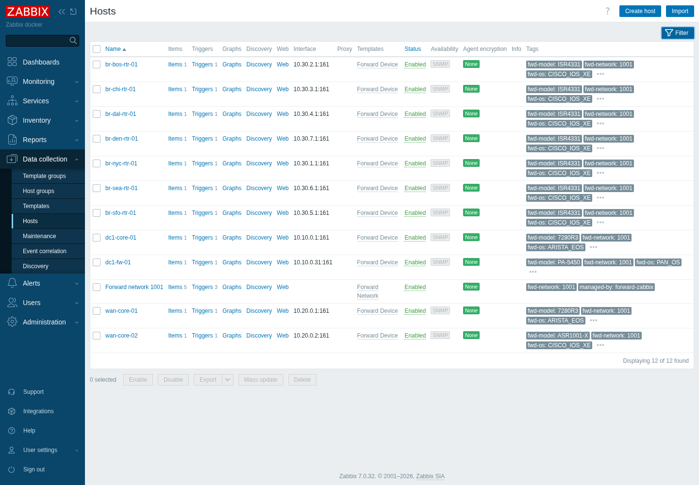
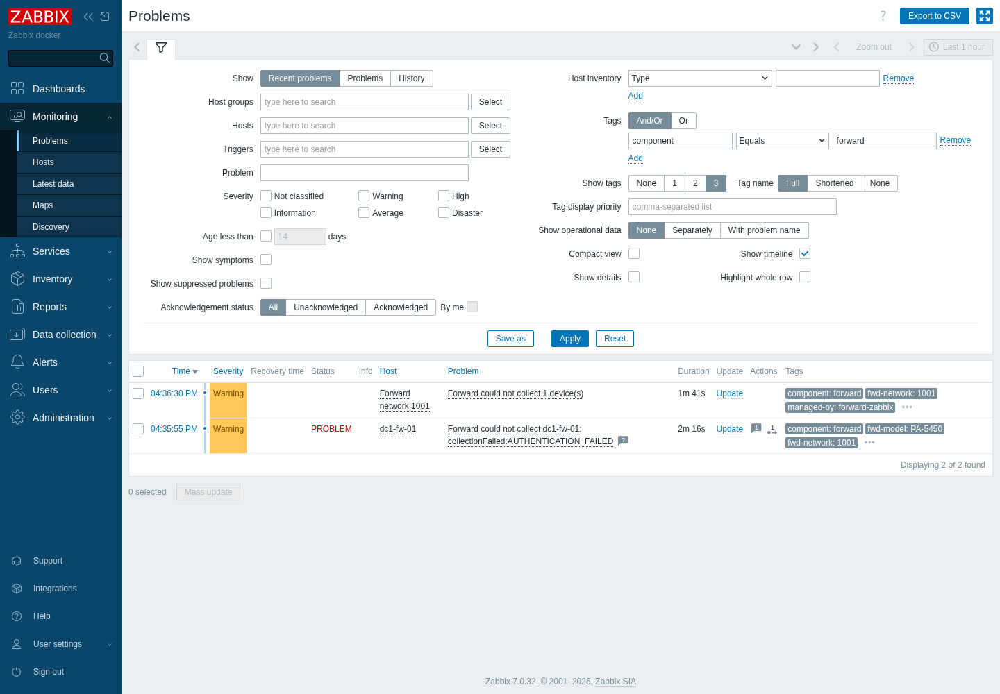
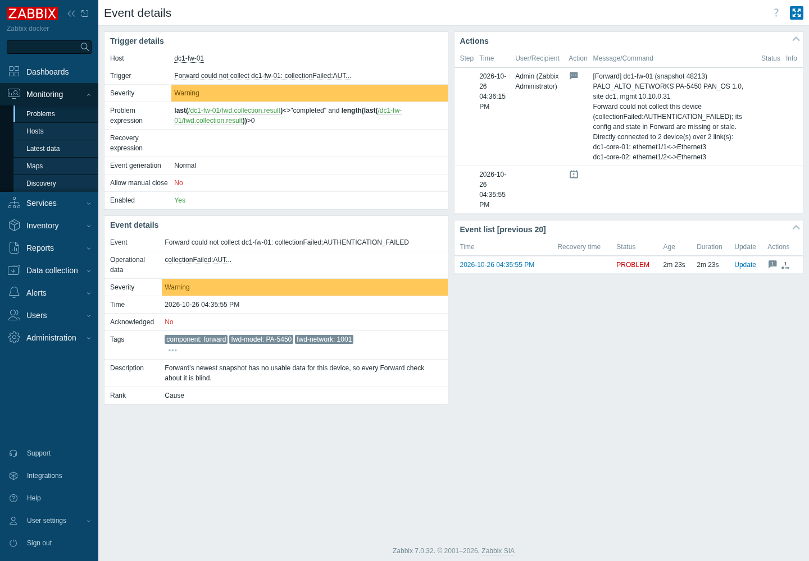

# forward-zabbix

Field integration between [Forward Networks](https://www.forwardnetworks.com/) and
[Zabbix](https://www.zabbix.com/). **Proof of concept; experimental.** It is not a Forward
product, carries no SLA, and may change without notice.

Forward is the source of truth for what the network *is* (devices, topology, config, policy).
Zabbix is the source of truth for what it is *doing now* (liveness, counters, alarms). This
project moves each one's knowledge to the other. See [DESIGN.md](DESIGN.md) for the full
sketch, including flows that are not built yet.

## Why use it

**What Forward gives Zabbix**

- *Zabbix populated without hand-building it.* Hosts, groups and tags come from Forward's inventory and stay in
  step. Tags (site, vendor, model, OS) ride along on problems, so routing and filtering need no extra work.
- *Forward's blind spots show up where you already look.* A device Forward cannot log in to, a snapshot that
  stopped arriving, or a failing check becomes a Zabbix problem, in the same pane as everything else.
- *Context on a problem.* An open problem gets a note with Forward's view of the device: what it is, whether
  Forward collected it, and what it connects to.
- *A coverage report neither tool can produce alone.* Devices Forward models that Zabbix does not monitor,
  Zabbix hosts Forward has never seen, and matches that disagree on name or IP.

**What Zabbix gives Forward**

This project never changes Forward on its own. Zabbix's knowledge reaches Forward in one way so far:
`fwdzbx export-status` writes a CSV of what Zabbix says about each device, which you can upload to Forward as
a data file for NQE to join (an optional step you run yourself; see
[Forward setup](docs/forward-setup.md#zabbix-data-in-nqe)). Other flows (a collection triggered by a Zabbix
event, before and after snapshots around a maintenance window, onboarding candidates) are designed in
[DESIGN.md](DESIGN.md) and not built.

## What works today

| Command | What it does |
|---|---|
| `fwdzbx devices` | Lists the devices Forward holds for a network (read-only). |
| `fwdzbx coverage-gap` | Diffs Forward's inventory against Zabbix hosts: devices Forward knows that Zabbix does not monitor, hosts Zabbix has that Forward does not model, and matches that differ (IP, or the same device under another name). |
| `fwdzbx sync-inventory [--apply]` | Creates and updates Zabbix hosts from Forward devices, linking the `Forward Device` template. Dry run unless `--apply`. |
| `fwdzbx push-status [--apply]` | Pushes Forward's per-device collection result and the newest snapshot's id and time to Zabbix trapper items. Zabbix then raises problems when Forward cannot collect a device, or when no new snapshot arrives. Dry run unless `--apply`. |
| `fwdzbx export-status [-o FILE]` | CSV of what Zabbix says about each Forward device (monitored, open problems, worst severity), for uploading to Forward as an NQE data file. Read-only. |
| `fwdzbx serve` | Receives Forward's snapshot webhook and pushes status to Zabbix at once. |
| `fwdzbx enrich [--apply]` | For each open Zabbix problem on a host this tool manages, adds an acknowledgement note with Forward's view of the device: identity, whether Forward collected it, and its directly connected neighbors with ports. Skips problems that already have a Forward note. Dry run unless `--apply`. |

Sync rules: it only ever creates or updates hosts it owns (tag `managed-by=forward-zabbix`).
A host it does not own with the same name, or the same IP, is reported as a collision and left
alone. Managed hosts whose device has disappeared are reported as stale and never deleted. A
second `--apply` with no changes does nothing.

Import `zabbix/forward-templates.yaml` into Zabbix once (Data collection > Templates > Import). It defines
`Forward Device` (a collection-result item and a trigger) and `Forward Network` (device counts, newest
snapshot id and time, triggers for collection failures and for no new snapshot within
`{$FWD.SNAPSHOT.MAX_AGE}`, default 36h). Run `sync-inventory --apply` before `push-status --apply`, so the
hosts exist. `push-status` names any value it skipped because the host has no item. Items are trapper
items, so nothing here polls devices; created hosts have an SNMP interface using `{$SNMP_COMMUNITY}` but
no polling template.

Not built yet: check results as metrics, and richer enrichment (config changes, blast radius beyond direct
neighbors). The webhook path is built and tested for snapshots; see [Validation](docs/validation.md) for what
was and was not run.

## Screenshots

Zabbix, populated by this project from synthetic data:





## Architecture

```
Forward --webhook--> fwdzbx serve --API / trapper--> Zabbix
Forward <--NQE / snapshots-- fwdzbx commands --------^
```

A standalone Python service; not a Zabbix plugin and not part of Forward. It reads Forward and writes only
to Zabbix. See [Architecture](docs/architecture.md).

## Documentation

[Overview](docs/index.md) | [Install](docs/install.md) | [Configuration](docs/configuration.md) |
[Zabbix setup](docs/zabbix-setup.md) | [Forward setup](docs/forward-setup.md) | [Usage](docs/usage.md) |
[Run as a service](docs/service.md) | [Python API and pipelines](docs/python-api.md) |
[Troubleshooting](docs/troubleshooting.md) | [Validation](docs/validation.md)

Also: `fwdzbx serve` receives Forward's snapshot webhook; `--json` on every command gives machine-readable
output; `fwdzbx` is importable (`import fwdzbx; fwdzbx.coverage_gap(...)`).

## Run it

Requires Python 3.12+, [uv](https://docs.astral.sh/uv/), Forward credentials (an API token's
access key and secret), and a Zabbix 7.0 server. Tested against Zabbix 7.0.32.

```bash
uv sync
export FORWARD_URL=https://your-forward-host FORWARD_USERNAME=... FORWARD_PASSWORD=...
export ZABBIX_URL=http://127.0.0.1:8081 ZABBIX_USER=... ZABBIX_PASSWORD=...   # or ZABBIX_TOKEN
uv run fwdzbx --network-id <id> coverage-gap
uv run fwdzbx --network-id <id> sync-inventory           # dry run
uv run fwdzbx --network-id <id> sync-inventory --apply
```

Credentials come from the environment only; nothing is written to disk.

A throwaway local Zabbix for trying it: `cd deploy && echo "ZBX_DB_PASSWORD=$(openssl rand -hex 12)" > .env && docker compose up -d`
(web UI on `127.0.0.1:8081`; Zabbix's default login is `Admin` / `zabbix`, so change it for anything
beyond a local test).

## Tests

```bash
uv run pytest
```

The unit tests cover the planning and diff logic with synthetic devices. They do not need Forward
or Zabbix.

## Layout

`src/fwdzbx/plan.py` holds the pure sync-planning and gap logic. `forward.py` and `zabbix.py` are
the two I/O edges (the [Forward Python SDK](https://pypi.org/project/forward-sdk/) and
[`zabbix-utils`](https://pypi.org/project/zabbix-utils/)). `receiver.py` is the webhook server, `api.py` the public Python API and `cli.py` the command line over it. `deploy/` has the systemd units, a throwaway Zabbix and `Dockerfile` is at the root.
