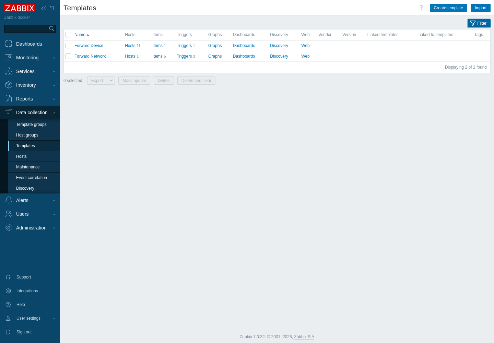
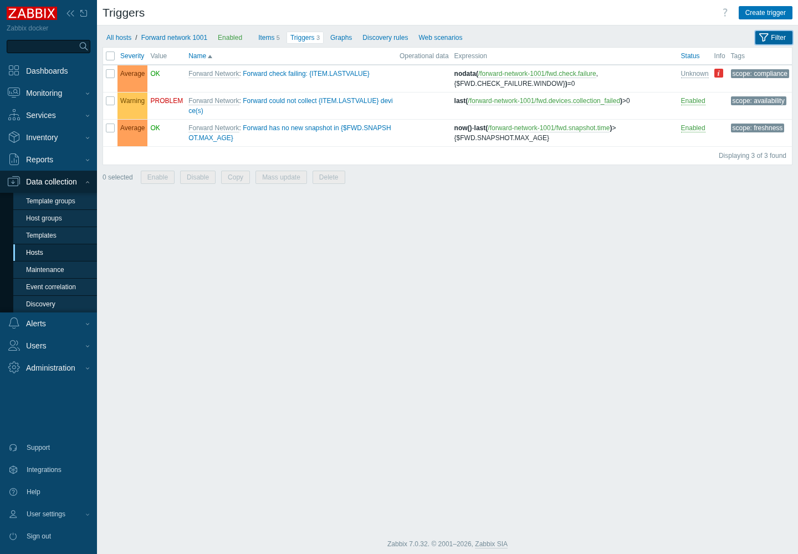
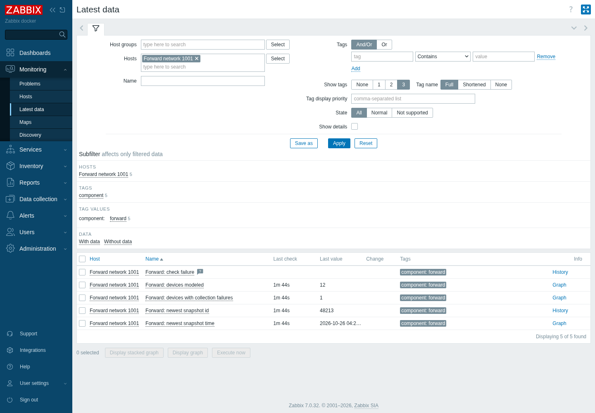

# Zabbix setup

## Import the templates

Zabbix: **Data collection > Templates > Import**, choose `zabbix/forward-templates.yaml`. Or by API (this
is what `examples/synthetic_demo` does): `configuration.import` with `createMissing` and `updateExisting`.

Two templates are created, in the template group `Templates/Network devices`:

| Template | Linked to | Items | Triggers |
|---|---|---|---|
| **Forward Device** | every synced device host | `fwd.collection.result` (trapper, text) | "Forward could not collect {HOST.NAME}: ..." (Warning) |
| **Forward Network** | one carrier host per Forward network, `forward-network-<id>` | `fwd.devices.total`, `fwd.devices.collection_failed`, `fwd.snapshot.id`, `fwd.snapshot.time`, `fwd.check.failure` | collection failures present; no new snapshot within `{$FWD.SNAPSHOT.MAX_AGE}`; a check is failing |

The templates carry no polling. The items are all **trapper** items: this project pushes values into them.

## What `sync-inventory --apply` creates

- A host per Forward device, named after the device, with an SNMP interface on the first management IP.
- Host groups `Forward`, `Forward/Sites/<site>`, `Forward/Vendors/<vendor>`.
- Tags `managed-by: forward-zabbix`, `fwd-network`, `fwd-site`, `fwd-vendor`, `fwd-model`, `fwd-os`, `fwd-type`, plus one `fwd-tag` per Forward device tag. Host tags flow into problems,
  so you can route and filter on them.

The network carrier host `forward-network-<id>` (bottom of the list above) is created by `push-status --apply` or the webhook receiver, not by `sync-inventory`.

## What `push-status` and the receiver feed

The `check failure` item has no value until a Forward check-failure event arrives.

## Problems

Both rows are real output of the code: one device Forward could not collect, and the roll-up on the network
host. The speech bubble on the device problem is the `enrich` note.

## The enrichment note

`fwdzbx enrich --apply` adds one acknowledgement message to each open problem on a managed host that has no `[Forward]` note:

The note names the device, whether Forward collected it, and its neighbors with ports. It is added once per
problem; a problem that already has a `[Forward]` message is skipped.

## Ownership rules

See [Usage](usage.md#ownership-rules).

## Performance template (optional)

`zabbix/forward-performance-template.yaml` adds the `Forward Performance by SNMP` template for feeding Forward's performance views; see [Performance data](performance.md). Import it the same way, link it to hosts with an SNMP interface, and set the global macro `{$SNMP_COMMUNITY}` once (Administration > Macros). Macros: `{$FWD.PERF.INTERVAL}` (default `5m`), `{$FWD.PERF.IFNAME.MATCHES}` / `.NOT_MATCHES`, `{$FWD.PERF.MEM.MATCHES}`. Tested on Zabbix 7.0.32 against one Arista cEOS lab device: 72 items discovered, none in error.
